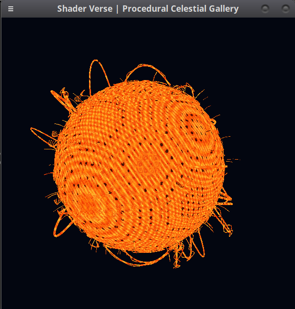
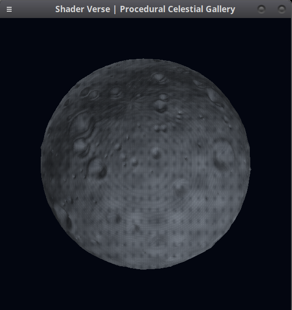
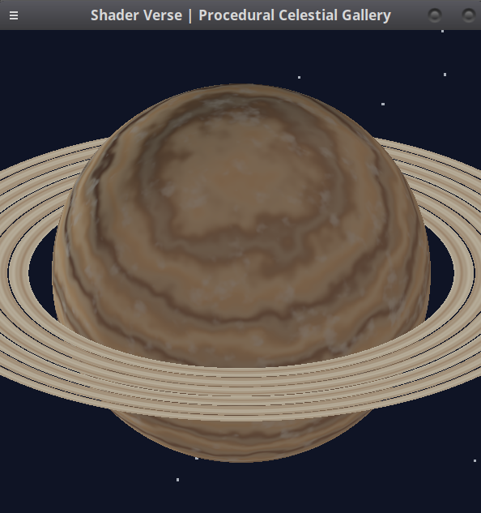
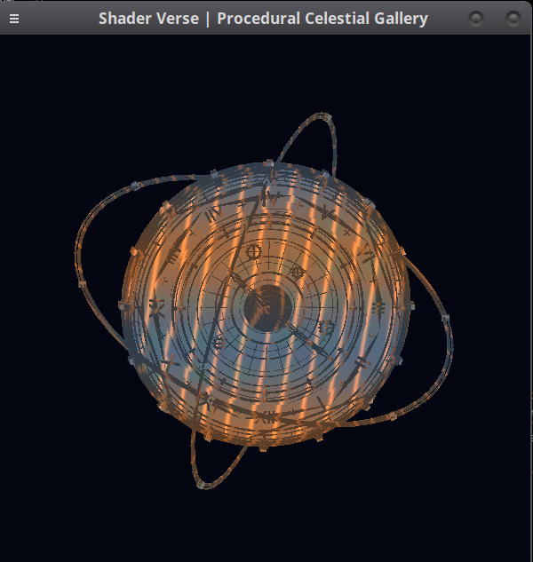
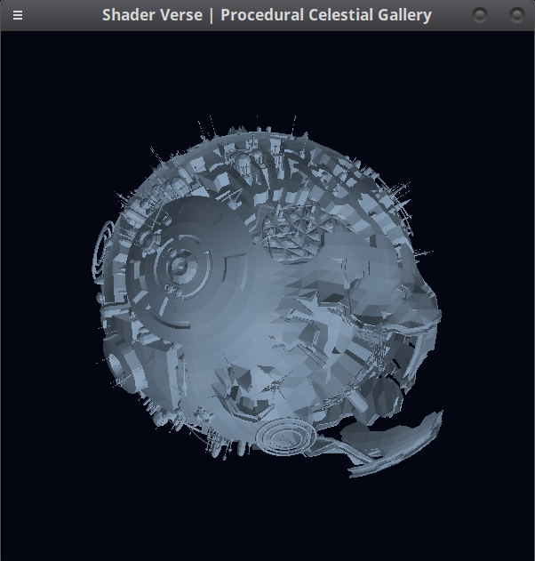
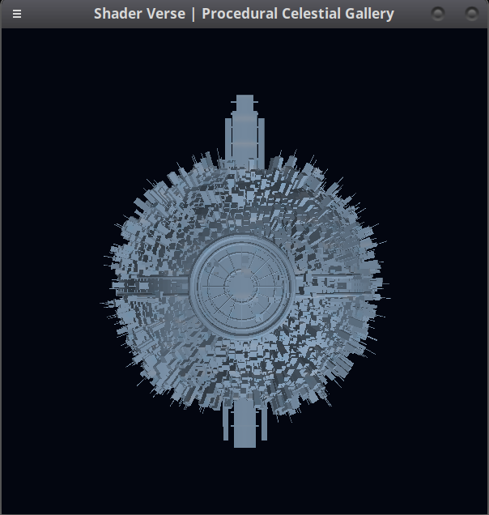

<div align="center">

# 🌌 SHADER VERSE

### Laboratorio 5 · Shaders · Gráficas por Computadora

**Una galería interactiva de mundos creados con geometría 3D y colores procedurales en Rust.**


**6 cuerpos celestes · Rotación interactiva · Anillos procedurales · Sin texturas de imagen**

</div>

---

## ✨ Acerca del proyecto

**Shader Verse** es un laboratorio de gráficas por computadora desarrollado en **Rust**. Su objetivo es crear la apariencia de cuerpos celestes mediante **shaders que calculan colores con operaciones matemáticas**, en lugar de utilizar texturas PNG/JPG o materiales importados.

La galería combina dos formas de representación: esferas renderizadas mediante cálculos procedurales y modelos tridimensionales diseñados en **Blender**, importados como geometría OBJ. El color final se calcula dentro del software renderer.

> **Nota:** La geometría de Blender aporta las formas (cráteres, engranajes, edificios y estructuras), mientras que Rust determina sus colores. La rotación y el menú son funcionalidades interactivas adicionales.

## 🪐 Galería celestial

### 01 · ☀️ Sun — Estrella

Modelo estelar con estructuras solares, filamentos y un shader que combina tonos incandescentes, granulación y variaciones de plasma.

<div align="center">
  
</div>

**Capas de color:** plasma base · granulación · filamentos · regiones oscuras.

### 02 · 🌑 Moon — Planeta rocoso

Mundo rocoso con relieve y cráteres modelados en Blender. El shader aporta variaciones minerales, zonas oscuras y polvo lunar.

<div align="center">
  
</div>

**Capas de color:** roca base · minerales · regiones oscuras · polvo lunar.

### 03 · 🪐 Zephyra — Gigante gaseoso

Planeta gaseoso con bandas de nubes, turbulencia atmosférica, tormentas y un **sistema de anillos generado matemáticamente**.

<div align="center">
  
</div>

**Efectos del shader:** bandas atmosféricas · turbulencia · nubes · tormenta. Los anillos se calculan sin imágenes de textura.

### 04 · ⚙️ Clock — Planeta mecánico

Un mundo de engranajes y estructuras orbitales con variaciones metálicas y reflejos cálidos calculados por el renderer.

<div align="center">
  
</div>

**Diseño visual:** metales oscuros · tonos cobrizos · variaciones de superficie · iluminación.

### 05 · 🔩 Mecanic — Planeta industrial

Un planeta formado por maquinaria y estructuras complejas, con una paleta de titanio gris azulado y acentos metálicos discretos.

<div align="center">
  
</div>

**Capas de color:** titanio · grafito · plata · energía naranja tenue.

### 06 · 🏙️ Building — Planeta-ciudad

Un mundo urbano cubierto por edificios, torres y una plataforma circular. Su shader conserva una apariencia de concreto y acero con variaciones frías y cálidas.

<div align="center">
  
</div>

**Capas de color:** concreto · acero · cristales azulados · luces ámbar discretas.

---

## 🎮 Controles

| Tecla | Acción |
|:---:|---|
| `1` | Mostrar **Sun** |
| `2` | Mostrar **Moon** |
| `3` | Mostrar **Zephyra** |
| `4` | Mostrar **Clock** |
| `5` | Mostrar **Mecanic** |
| `6` | Mostrar **Building** |
| `←` / `→` | Girar horizontalmente |
| `↑` / `↓` | Inclinar verticalmente |
| `Espacio` | Activar o pausar la animación |
| `R` | Restablecer la orientación |
| `M` | Mostrar u ocultar el menú |
| `Esc` | Cerrar la aplicación |

> Para observar un planeta sin que el panel cubra parte de la imagen, presiona `M`.

## 🎨 ¿Cómo funcionan los shaders?

Los shaders producen los colores de las superficies mediante cálculos realizados en Rust. Entre las técnicas utilizadas están:

- **Interpolación de colores (`lerp` / `mix`):** transición entre distintas tonalidades.
- **Funciones trigonométricas:** patrones de bandas, regiones y detalles superficiales.
- **Ruido procedural y FBM:** variaciones irregulares y turbulencia.
- **Iluminación:** cambios de intensidad según la orientación de la superficie.
- **Transformaciones 3D:** rotación de los cuerpos celestes mediante matrices.
- **Profundidad:** uso de un búfer de profundidad para representar las superficies visibles de los modelos.

Cada cuerpo utiliza una combinación distinta de efectos. Las capas de color se pueden identificar en las funciones de shader del código fuente, especialmente en `src/shaders/` y `src/clock.rs`.

**Restricción principal:** no se usan texturas de imagen ni materiales importados de Blender para colorear los cuerpos celestes.

## 🧰 Tecnologías

| Tecnología | Uso |
|---|---|
| **Rust** | Implementación del software renderer y shaders |
| **glam** | Vectores y matrices para cálculos 3D |
| **minifb** | Ventana y framebuffer |
| **tobj** | Lectura de geometría OBJ |
| **font8x8** | Texto del menú dentro del framebuffer |
| **Blender** | Modelado de geometría tridimensional original |

## 🚀 Ejecución

### Requisitos

- Rust y Cargo instalados.
- Un entorno gráfico de escritorio compatible con `minifb`.

Desde la **raíz del repositorio**, ejecutar:

```bash
cargo run --release
```

La aplicación necesita que los modelos OBJ usados por el programa estén presentes en `assets/models/`.

## 📁 Estructura principal

```text
shader-verse/
├── assets/
│   └── models/           # Geometría OBJ utilizada por el renderer
├── screenshots/
│   ├── sun.png
│   ├── moon.png
│   ├── zephyra.png
│   ├── clock.png
│   ├── mecanic.png
│   └── building.png
├── src/
│   ├── main.rs           # Ventana, selección y ciclo principal
│   ├── clock.rs          # Carga y renderizado de modelos 3D
│   ├── menu.rs           # Interfaz del menú
│   ├── noise.rs          # Funciones de ruido y color
│   ├── rings.rs          # Anillos procedurales
│   └── shaders/          # Shaders de cuerpos procedurales
├── Cargo.toml
└── README.md
```

## 📋 Relación con la rúbrica

| Requisito del laboratorio | Implementación |
|---|---|
| Estrella | **Sun** |
| Planeta rocoso | **Moon** |
| Gigante gaseoso | **Zephyra** |
| Capas de color mediante shaders | Efectos procedurales implementados en Rust |
| Planetas adicionales | **Clock**, **Mecanic** y **Building** |
| Anillos | Sistema de anillos de **Zephyra** |
| Rotación y traslación (opcional) | Rotación manual y automática; no se afirma traslación orbital |
| Capturas | Seis imágenes reales en `screenshots/` |

> La puntuación final y la aceptación de los cuerpos adicionales dependen de la evaluación del docente.

---

<div align="center">

**Shader Verse · Laboratorio 5 — Gráficas por Computadora**

*Modelado en Blender · Renderizado y coloreado en Rust*

</div>